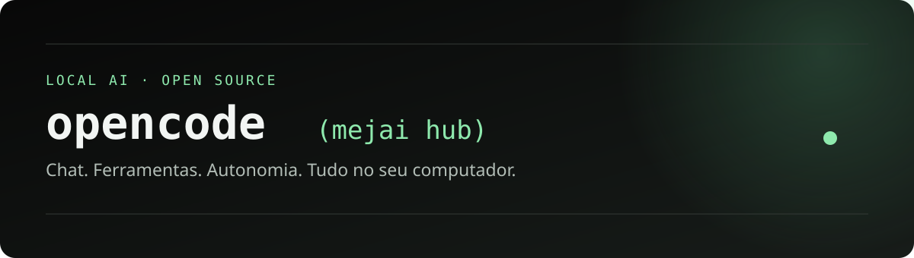

# OpenCode (mejai hub)

**[Atualização do chat](https://github.com/m3j4i/opencode-mejai-hub/releases/tag/v1.18.35-mejai.1-hub.20261015) · [Baixar o pacote completo](https://github.com/m3j4i/opencode-mejai-hub/releases/tag/v1.18.35-mejai.1-hub.20261014) · [Documentação](mejai/docs/) · [Reportar um problema](https://github.com/m3j4i/opencode-mejai-hub/issues)**

> **Versão experimental, pronta para uso local e avaliação.** Os testes de integração foram executados com serviços isolados. A qualidade das tarefas depende do modelo e das ferramentas configuradas.

**Navegação rápida:** [Skills](#skills-incluidas) · [Patches](#patches-da-fork) · [Diferenças da fork](#-o-que-muda-nesta-fork) · [Chat](#-chat-feito-para-acompanhar-o-trabalho) · [Autonomia](#-autonomia-com-controles-e-limites) · [Ferramentas](#-ferramentas-para-trabalhar-além-do-código) · [Instalação](#-instalação) · [Desenvolvimento](#desenvolvimento) · [Licença](#-créditos-e-licença)

**Um assistente local para pesquisar, criar documentos, organizar arquivos, automatizar tarefas e desenvolver projetos — com chat, ferramentas e autonomia reunidos em um Hub.**

O Mejai Hub nasceu de uma fork do [OpenCode](https://github.com/anomalyco/opencode), preparada para trabalhar com modelos locais através do Ollama e, opcionalmente, do Colibri.

A proposta é simples: você descreve o resultado desejado, acompanha o trabalho pelo chat e decide quando permitir que o agente continue sozinho. O projeto reúne uma interface própria, ferramentas instaladas, regras de execução, skills e patches no motor do OpenCode.

## ✨ O que muda nesta fork?

O OpenCode fornece a base de execução, sessões e ferramentas. Esta distribuição acrescenta:

- **Hub próprio:** chat, escolha de modelos, editor de regras e manutenção em uma interface com a estética do OpenCode.
- **Uso geral:** regras e ferramentas voltadas também a pesquisa, documentos, downloads e organização de arquivos, sem exigir um repositório de código para cada tarefa.
- **Autonomia por conversa:** iniciar, pausar e retomar o trabalho pelo chat, com limites e acompanhamento do progresso.
- **Python nativo:** uma ferramenta adicionada ao motor da fork para executar código Python, incluindo scripts com múltiplas linhas e aspas.
- **Integração local preparada:** descoberta dos modelos do Ollama, preparação antecipada das ferramentas e suporte opcional ao Colibri.
- **Patches de execução e recuperação:** tratamento de falhas, preservação do contexto em sessões longas e continuação limitada de respostas que encerram o trabalho cedo demais.
- **Proteção da fork:** atualização oficial do OpenCode bloqueada para evitar substituir o motor e perder os patches específicos do projeto.

## 💬 Chat feito para acompanhar o trabalho

- Markdown com tabelas, listas e blocos de código copiáveis.
- Scripts apresentados no próprio chat, além do caminho do arquivo produzido.
- Envio com **Enter** e quebra de linha com **Shift + Enter**.
- Upload de arquivos, arrastar e soltar e colar imagens.
- Edição e reenvio de mensagens em uma nova conversa, preservando a conversa original.
- Acesso às conversas e exclusão diretamente pelo chat, com confirmação.
- Histórico dos trechos de **thinking disponibilizados pelo modelo**, inclusive ao reabrir a conversa.
- Atualização do progresso, ações e resultados das ferramentas durante a execução.

Os uploads aceitam até **10 arquivos por mensagem e 50 MB por arquivo**. Imagens e PDFs são enviados ao modelo quando ele declara suporte; outros arquivos ficam disponíveis às ferramentas. Fazer upload não executa o arquivo.

## 🔁 Autonomia com controles e limites

Você pode iniciar a autonomia em uma conversa nova ou retomar uma tarefa existente. O agente recebe instruções para derivar um plano e critérios de conclusão a partir do pedido, mantendo o objetivo e as correções do usuário.

- Continuação automática das etapas pendentes quando um turno termina.
- Mensagens internas curtas e identificadas para reduzir a poluição do chat.
- Limites ajustáveis de tempo e de continuações.
- Pausa diante de perguntas, permissões pendentes, erros ou repetição sem progresso observável.
- Registros de progresso e evidências das ações executadas.
- Retomada explícita após reiniciar o agente.
- Indicadores visuais para estados de funcionamento, atividade e parada.

A indicação de conclusão é um relato do agente, acompanhado das evidências disponíveis. A autonomia não garante que qualquer pedido será concluído corretamente; o modelo, as ferramentas e os recursos da máquina continuam determinando o resultado.

## 🧰 Ferramentas para trabalhar além do código

- **Documentos:** ferramentas e bibliotecas para Word, Excel, PowerPoint e PDF.
- **OCR:** extração de texto de imagens e páginas digitalizadas.
- **Desenvolvimento:** Python, terminal e Serena para explorar código e trabalhar com símbolos.
- **Pesquisa:** busca na web e navegação com Camoufox ou Chromium.
- **Downloads:** acompanhamento, retomada e verificações para detectar arquivos inválidos ou páginas HTML salvas como documentos.
- **Integrações MCP:** catálogo de ferramentas carregadas sob demanda, com configuração de contas quando necessário.

As regras, skills e verificações acompanham o modelo selecionado. A disponibilidade de recursos depende das capacidades do modelo, da plataforma e das integrações configuradas.

### O que já acompanha os pacotes

| Área | Componentes preparados | O que permitem fazer |
| --- | --- | --- |
| Python e documentos | Python, python-docx, openpyxl, python-pptx, pypdf e PyMuPDF | Ler e produzir documentos, planilhas, slides e PDFs; executar scripts de processamento. |
| OCR local | RapidOCR e ONNX Runtime | Extrair texto de imagens e PDFs digitalizados usando CPU. |
| Navegação | Camoufox, Chromium e Playwright | Inspecionar páginas dinâmicas, preencher formulários, lidar com abas, screenshots e downloads. |
| Código | Serena, servidores de linguagem Python/JS/TS e ast-grep | Navegação por símbolos, referências, refatoração e busca estrutural. |
| Depuração | DebugMCP e adaptador Python/debugpy | Breakpoints, inspeção de variáveis e execução passo a passo; outras linguagens precisam de adaptador. |
| Arquivos e processos | Filesystem MCP e Desktop Commander | Ler, editar e pesquisar arquivos, usar terminal e acompanhar processos. |
| Memória e notas | Memory MCP e adaptador Obsidian | Grafo de memória persistente e leitura/escrita/pesquisa de notas Markdown locais. |
| Mídia e arquivos compactados | FFmpeg/ffprobe e 7-Zip/7zz | Processamento e inspeção de mídia, extração e verificação de arquivos pelo terminal. |
| Ambiente | Node.js, cliente Tor, Git/PowerShell no Windows e preparação Linux | Executar o Hub e seus adaptadores usando os caminhos da distribuição. Git e Bash são dependências do sistema no Linux. |

Os adaptadores locais para **SQLite**, **PostgreSQL**, **MySQL** e **Docker** também acompanham o projeto. SQLite funciona sem servidor; PostgreSQL/MySQL exigem conexão e Docker exige um engine externo. Consultas SQL usam parâmetros e começam em modo de leitura, salvo solicitação explícita de escrita.

O catálogo tem **39 entradas**, incluindo aliases, conectores remotos e requisitos externos. Context7, DeepWiki, GitHub, Brave, Notion, Linear, Slack, Figma, Apify, Atlassian e outros estão documentados no [catálogo completo](docs/MEJAI-CATALOG.md). Contas, chaves, planos pagos e serviços externos são configurados pelo usuário. A entrada Ego Lite está marcada como indisponível nesta versão.

### Ferramentas carregadas quando são necessárias

O roteador **habilidades** expõe quatro operações: status, search, details e call. O agente procura uma capacidade, lê o schema real e chama a ferramenta com os argumentos documentados. Os servidores são conectados sob demanda, evitando iniciar todos os conectores ou incluir todos os seus schemas em cada conversa.

Isso permite manter um conjunto amplo de ferramentas acessível ao modelo local, com menos preparação desnecessária e tratamento explícito de dependências ausentes. Regras de uso e permissões continuam valendo para cada ação.

## 📚 Skills que acompanham a fork

As skills são instruções de trabalho carregáveis pelo OpenCode. Elas ensinam como usar as ferramentas e conferir resultados; complementam as regras gerais aplicadas a todos os modelos selecionados.

| Skill | Fluxo de trabalho |
| --- | --- |
| [browser-downloads](mejai/skills/browser-downloads/SKILL.md) | Pesquisar fontes reais, baixar usando a sessão de navegador e conferir tipo, tamanho e integridade. |
| [debug-live](mejai/skills/debug-live/SKILL.md) | Investigar bugs com breakpoints, variáveis, passos e inspeção da execução. |
| [ferramentas-sob-demanda](mejai/skills/ferramentas-sob-demanda/SKILL.md) | Descobrir adaptadores, ler schemas e lidar corretamente com contas, bancos e serviços externos. |
| [find-skills](mejai/skills/find-skills/SKILL.md) | Encontrar habilidades adicionais no ecossistema e orientar sua instalação. |
| [systematic-debugging](mejai/skills/systematic-debugging/SKILL.md) | Investigar a causa antes de alterar código para corrigir um sintoma. |
| [tor-navegacao](mejai/skills/tor-navegacao/SKILL.md) | Usar Torch pelo perfil Tor, verificar a rota e tratar downloads e falhas sem conexão direta como alternativa. |
| [verification-before-completion](mejai/skills/verification-before-completion/SKILL.md) | Exigir evidências de verificação antes de declarar uma tarefa concluída. |

As regras de [INSTRUCOES.md](mejai/INSTRUCOES.md), [RECUPERACAO.md](mejai/RECUPERACAO.md), [WEB-E-MCP.md](mejai/WEB-E-MCP.md) e [LANGUAGE.md](mejai/LANGUAGE.md) cobrem escopo, recuperação, pesquisa e idioma. Instalar uma skill não autoriza publicação, envio de mensagens, compras ou ações fora do pedido do usuário.

## 🔧 Patches e mudanças no comportamento

Esta fork reúne alterações no motor, no Hub e nos plugins. São seis plugins principais configurados automaticamente, apoiados por módulos específicos de validação, contexto e recuperação.

| Mudança | Problema tratado e comportamento resultante |
| --- | --- |
| Python nativo no motor | Scripts com múltiplas linhas e aspas são executados por uma ferramenta com campo source, timeout, cancelamento, permissão e saída limitada, reduzindo problemas de escape do shell. |
| Shell por plataforma | O terminal usa PowerShell 7 no Windows e Bash no Linux, com os caminhos do Python e das ferramentas preparados para cada pacote. |
| Validação de execução e artefatos | Registra erros de comandos, verifica sintaxe de formatos suportados e avisa sobre saídas inválidas ou incompletas. Existência do arquivo e exit code zero continuam sem provar a correção final. |
| Contexto de sessões longas | Mantém um registro limitado do objetivo, correções humanas, checklist, artefatos, checks e falhas para apoiar a continuação após compactação. Lembretes automáticos são diferenciados de novos pedidos humanos. |
| Recuperação de respostas vazias ou prematuras | Pode continuar uma tarefa após resposta vazia, promessa curta ou etapas ainda pendentes, com limites e verificação de progresso para conter loops. |
| Pesquisa com evidências | Conserva URLs fornecidas ou observadas e orienta a verificar fonte, conteúdo e data. Endereço plausível ou snippet de busca não vira prova de acesso. |
| Repetição de falhas HTTP | Interrompe a repetição do mesmo endereço após falhas 403/404 recorrentes e pede outra fonte verificada ou um relato do bloqueio. |
| Entrega de código no chat | Orienta apresentar scripts e trechos úteis diretamente; o chat também pode recuperar código de escritas/edições bem-sucedidas do turno, dentro de limites. |
| Preparação da primeira mensagem | Inicializa conexões e schemas e pode carregar antecipadamente o modelo Ollama selecionado, sem gerar uma resposta de teste. |
| Autonomia com estado persistido | Usa o checklist e evidências observáveis para continuar, pausar diante de bloqueios e exigir retomada após reiniciar o agente. |
| Preservação da fork | Bloqueia a atualização oficial no motor e nas configurações do Hub para proteger as alterações específicas. |

Veja os [plugins](mejai/plugins/), a [ferramenta Python](packages/opencode/src/tool/python.ts) e a [preparação da primeira mensagem](mejai/first-message.mjs). Essas proteções apoiam a execução; o agente ainda depende do modelo e da verificação do resultado solicitado.

## 🌐 Navegação, Tor e Torch

Camoufox e Chromium podem trabalhar sem abrir uma janela de navegador. A navegação Tor utiliza perfil separado, proxy SOCKS local, DNS remoto e bloqueio de WebRTC.

Para pesquisas solicitadas na rede Tor ou em serviços onion, **Torch é o mecanismo preferido configurado**. O cliente oficial Tor cuida dos circuitos e da atualização do consenso de relays. A navegação comum bloqueia destinos onion para evitar acessos fora do caminho Tor configurado.

Os serviços e buscas dependem da disponibilidade da rede. Esta integração não promete o mesmo nível de anonimato do Tor Browser.

## 🧠 Ollama e Colibri

**Ollama** é o caminho principal para modelos locais: o Hub descobre o catálogo disponível e permite trocar de modelo conforme a tarefa. A preparação antecipada pode carregar o modelo e inicializar ferramentas antes da primeira mensagem, sem gerar uma resposta de teste.

**Colibri** acompanha a distribuição como alternativa opcional. Ele permanece inativo até você configurar um modelo compatível e iniciá-lo manualmente. As opções CPU/Vulkan dependem do modelo, do backend e do hardware.

Os pacotes não incluem pesos de modelos Ollama/Colibri. Recursos internos necessários ao OCR e às demais ferramentas fazem parte dos runtimes.

## 🎛️ Regras, manutenção e idiomas

O Hub oferece editor de regras e configurações, diagnóstico, testes isolados, acesso aos arquivos de trabalho e operações de manutenção. Exclusão e reset apresentam confirmação; as configurações e os runtimes preservados não são apagados para forçar uma recuperação.

Textos da interface e explicações dos botões ficam em arquivos `.language`, facilitando novas traduções. Há seleção de idioma e uma opção para procurar novos arquivos na pasta `linguagens/`.

**Idiomas incluídos:** português brasileiro, inglês e russo. Mensagens do usuário, respostas do modelo e código mantêm seu idioma original.

## 📦 Instalação

Baixe o pacote correspondente ao seu sistema na [Release v1.18.35-mejai.1-hub.20261014](https://github.com/m3j4i/opencode-mejai-hub/releases/tag/v1.18.35-mejai.1-hub.20261014) e confira o [SHA256SUMS.txt](https://github.com/m3j4i/opencode-mejai-hub/releases/download/v1.18.35-mejai.1-hub.20261014/SHA256SUMS.txt).

| Download | Arquitetura | Tamanho aproximado |
| --- | --- | --- |
| [🪟 Windows](https://github.com/m3j4i/opencode-mejai-hub/releases/download/v1.18.35-mejai.1-hub.20261014/opencode-mejai-windows-x64-1.18.35-mejai.1-hub.20261014.7z) | x86_64 | 1,96 GiB |
| [🐧 Linux](https://github.com/m3j4i/opencode-mejai-hub/releases/download/v1.18.35-mejai.1-hub.20261014/opencode-mejai-linux-x64-1.18.35-mejai.1-hub.20261014.tar.xz) | x86_64 | 1,67 GiB |
| [📂 Código-fonte completo](https://github.com/m3j4i/opencode-mejai-hub/releases/download/v1.18.35-mejai.1-hub.20261014/opencode-mejai-source-1.18.35-mejai.1-hub.20261014.zip) | Fonte | cerca de 75 MiB |

| Pacote | Como iniciar |
| --- | --- |
| Windows x64 | Extraia o `.7z` inteiro com 7-Zip ou ferramenta compatível e abra `Iniciar.cmd`. |
| Linux x64 | Extraia o `.tar.xz` preservando links e permissões e execute `./start.sh`. |
| Código-fonte | Inclui a fork completa, o Hub, ferramentas próprias, plugins, skills, idiomas e testes. |

Instale e inicie o **Ollama** separadamente, baixe um modelo adequado ao seu computador e selecione-o no Hub. Mantenha a pasta completa em um local com permissão de escrita.

Os pacotes começam sem conversas, contas, credenciais ou perfis pessoais de navegador. Os dados de uso são criados localmente após iniciar.

**Linux validado:** Ubuntu 26.04 x86_64 via WSL. Outras distribuições e arquiteturas ainda não foram verificadas. Git precisa estar disponível no sistema Linux.

### Primeiro uso

1. Instale o [Ollama](https://ollama.com/) e baixe um modelo compatível com sua memória e seu hardware.
2. Extraia o pacote inteiro. No Windows, use [7-Zip](https://www.7-zip.org/) ou outro extrator compatível.
3. Abra o iniciador da sua plataforma e selecione o modelo no Hub.
4. Abra o chat, descreva seu objetivo e acompanhe os resultados das ferramentas.
5. Ative a autonomia no chat quando quiser permitir que o agente continue as etapas pendentes.

### Atualizar uma instalação

As atualizações oficiais estão bloqueadas para preservar esta fork. Extraia a nova versão em outra pasta, faça backup dos dados existentes e confira a compatibilidade antes de migrar. Esta versão não inclui um atualizador automático de releases da fork.

## 🛠️ Desenvolvimento e organização

A base nativa corresponde ao OpenCode **v1.18.35**, commit [53d1eabb61e2](https://github.com/anomalyco/opencode/tree/53d1eabb61e21162157817bf677da0a4ad3332e3), com versão da fork **1.18.35-mejai.1**.

| Caminho | Responsabilidade |
| --- | --- |
| `packages/opencode/` | Motor nativo, ferramenta Python e bloqueio da atualização upstream. |
| `mejai/ui/` | Chat e interface do Hub. |
| `mejai/src/` e `mejai/lib/` | Controladores, serviços, repositórios e módulos de apoio. |
| `mejai/plugins/` | Patches e extensões de execução e contexto. |
| `mejai/skills/` | Instruções e habilidades especializadas. |
| `mejai/linguagens/` | Catálogos de tradução da interface. |
| `mejai/testes/` e `mejai/release/` | Regressões, empacotamento e validação das distribuições. |

Consulte o [guia de compilação](docs/BUILD-MEJAI.md), as [regras de programação](mejai/AGENTS.md) e a [documentação do Hub](mejai/docs/). O código-fonte requer dependências de desenvolvimento; os arquivos portáteis incluem seus runtimes.

Para contribuir, siga [CONTRIBUTING.md](CONTRIBUTING.md). Relate problemas incluindo sistema, versão, modelo usado, etapas para reproduzir e mensagens de erro, removendo credenciais e conversas pessoais.

## 🧪 Estado atual e verificações

A distribuição `1.18.35-mejai.1-hub.20261014` foi verificada com:

- 28 grupos de regressão no Windows e 26 no Linux.
- 7 testes de empacotamento e 2 testes da ferramenta Python nativa.
- Verificações de sintaxe, lint, formatação e tamanho dos novos módulos.
- Integridade dos três arquivos compactados.
- Extração em outras pastas e primeira inicialização com zero conversas.
- Carregamento de ferramentas de documentos, OCR e Serena, além de Chromium e Camoufox.

Essas verificações usaram um serviço Ollama simulado, sem prompts reais. Elas não constituem um benchmark de qualidade dos modelos. Laya permanece em avaliação e não controla a autonomia desta versão.

## 🤝 Créditos e licença

Construído sobre o [OpenCode](https://github.com/anomalyco/opencode), com integrações de projetos como Ollama, Colibri, Camoufox, Playwright, Tor e Serena.

O código do projeto é distribuído sob **MIT**. Os componentes de terceiros mantêm suas próprias licenças. Consulte [LICENSE](LICENSE) e [THIRD-PARTY-NOTICES.md](THIRD-PARTY-NOTICES.md) antes de redistribuir os pacotes.

